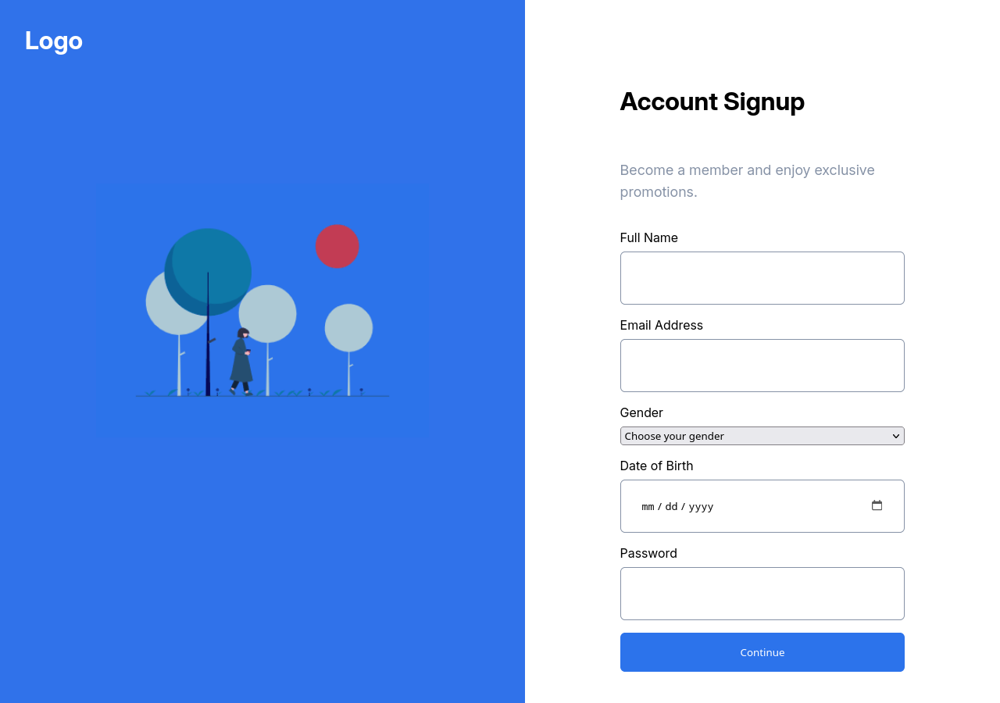
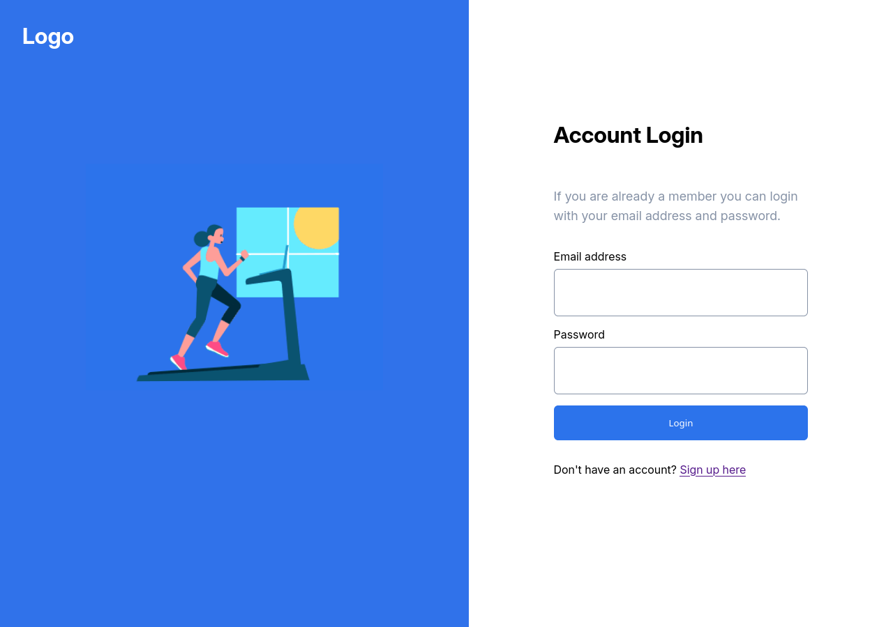

# Food Ordering Backend NodeJs V1.0

## 1. Mô tả dự án

Backend REST API quản lý món ăn, voucher, đơn hàng và chi tiết đơn hàng. Dự án có thêm giao diện đăng ký, đăng nhập và trang báo đăng nhập thành công theo quyền tài khoản.

### Chạy dự án

1. Chạy `npm install` và tạo database MySQL.
2. Tạo `.env` ở thư mục gốc. Điền cấu hình kết nối và dùng `openssl rand -hex 32` để tạo hai giá trị riêng cho `JWT_SECRET` và `JWT_REFRESH_SECRET`.

   ```dotenv
   PORT=8000
   DB_HOST=127.0.0.1
   DB_PORT=3306
   DB_NAME=food_ordering
   DB_USER=your_mysql_user
   DB_PASSWORD=your_mysql_password
   DB_DIALECT=mysql
   JWT_SECRET=replace_with_generated_secret
   JWT_EXPIRES_IN=30m
   JWT_REFRESH_SECRET=replace_with_another_generated_secret
   JWT_REFRESH_EXPIRES_IN=7d
   ```

3. Chạy `npm start`. Sequelize tạo các bảng còn thiếu khi khởi động. Mở [trang đăng nhập](http://localhost:8000/login.html) trên trình duyệt.

## 2. Các chức năng

- CRUD món ăn, voucher, đơn hàng và chi tiết đơn hàng qua `/foods`, `/vouchers`, `/orders` và `/order-details`.
- **Đăng ký** qua `POST /auth/register`. Form nhận họ tên, email, mật khẩu, giới tính và ngày sinh. Backend băm mật khẩu và cấp quyền `user` cho tài khoản mới.

  

- **Đăng nhập** qua `POST /auth/login`. API kiểm tra email và mật khẩu, rồi trả access token, refresh token và thông tin tài khoản khi xác thực thành công.

  

- **Chuyển trang theo quyền**. Trình duyệt đọc `user.role` từ phản hồi đăng nhập. Quyền `admin` mở `/successLogin.html`, còn quyền `user` mở `/successUser.html`.

  

  

### Thử hai quyền trên máy phát triển

Đăng ký một tài khoản và đăng nhập để thử giao diện User. Để thử giao diện Admin, đăng ký một tài khoản thử riêng, rồi chạy câu SQL dưới đây trên database phát triển. Đổi email cho khớp tài khoản thử và đăng nhập lại.

```sql
UPDATE Users SET role = 'admin' WHERE email = 'admin@example.test';
```

Các trang Success là trang báo kết quả. Các thao tác thêm, sửa và xóa món ăn yêu cầu `Authorization: Bearer <accessToken>` và quyền `admin`. API trả `401` khi thiếu token hoặc token không hợp lệ, và `403` khi tài khoản thiếu quyền.

Gửi `POST /auth/refresh` với JSON `{"refreshToken":"<refreshToken>"}` để nhận access token mới.

## 3. Công nghệ sử dụng

- Node.js và Express cho REST API và phục vụ trang HTML.
- MySQL và Sequelize để lưu dữ liệu.
- bcrypt để băm mật khẩu và jsonwebtoken để ký JWT.
- HTML, CSS và JavaScript với Fetch API cho giao diện.
